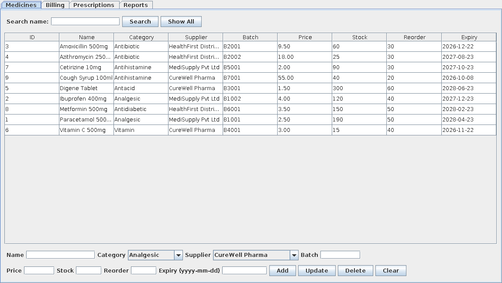
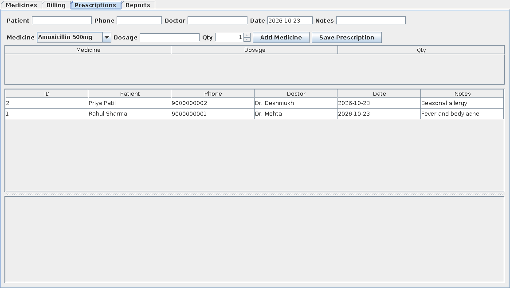

# Pharmacy Management System

Desktop application for managing a pharmacy: medicine inventory, automatic billing and prescription tracking.
Built with **Java (Swing)**, **JDBC** and **MySQL**.

## Features
- **Normalized MySQL schema (3NF)** – `categories`, `suppliers`, `medicines`, `customers`, `doctors`, `prescriptions`, `prescription_items`, `bills`, `bill_items` with foreign keys, CHECK constraints and indexes.
- **Medicines** – add / update / delete / search, linked to category and supplier.
- **Billing** – build a cart, bill total is calculated automatically, stock is deducted in a single **JDBC transaction** (rolls back on failure; expired or out-of-stock medicines cannot be sold). A printable receipt is generated.
- **Prescriptions** – record patient, doctor and multiple medicines with dosage; view items per prescription; link a prescription to a bill.
- **Reports (SQL joins + aggregations)** – stock levels, low stock, expired / expiring soon, daily sales, top-selling medicines, sales by category, all bills. The same queries are in `database/reports.sql`.

## Screenshots
| Medicines | Prescriptions |
|---|---|
|  |  |

## Requirements
- JDK 17 or newer
- MySQL 8.x (running locally)
- Maven 3.6+ (recommended), or just the MySQL connector jar (see option B)

## Setup
**1. Create the database (schema + sample data)**
```bash
mysql -u root -p < database/schema.sql
```

**2. Configure the connection** – edit `db.properties` (username / password):
```properties
db.url=jdbc:mysql://localhost:3306/pharmacy_db?useSSL=false&allowPublicKeyRetrieval=true&serverTimezone=UTC
db.user=root
db.password=root
```

**3. Run** (always from the project root folder, so `db.properties` is found)

*Option A – Maven*
```bash
mvn clean package
java -jar target/pharmacy-management-system-1.0.jar
```
*Option B – without Maven*: download `mysql-connector-j-8.x.jar` from https://dev.mysql.com/downloads/connector/j/ (Platform Independent), place it in the `lib/` folder, then run `./run.sh` (Linux/Mac) or `run.bat` (Windows).

## Project structure
```
database/schema.sql      tables, constraints, indexes, sample data
database/reports.sql     stock / expiry / sales report queries
db.properties            DB connection settings
src/main/java/pharmacy/
  Main.java              app entry point (tabbed window)
  Db.java                JDBC connection + query helpers
  BillingService.java    transactional billing + receipt
  MedicinePanel.java  BillingPanel.java  PrescriptionPanel.java  ReportsPanel.java
```

## Troubleshooting
- *"Cannot connect to MySQL"* – start MySQL, run `database/schema.sql`, check `db.properties`.
- *"Access denied"* – wrong username/password in `db.properties`.
